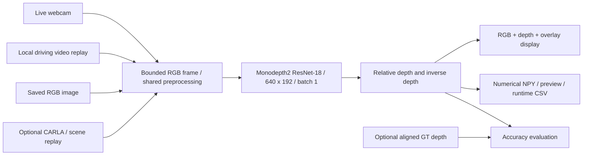

# Hardware-Friendly Implementation Plan

Updated: 18 October 2026. Duration: ten working days in five phases of two days each. Original practical prototype review date: 15 October 2026.

## Scope decision

The user's latest instruction supersedes the supplied PDF as the implementation constraint. Preserve RGB-only monocular depth prediction, live visualization, overlays, numerical outputs, and measured performance. Target GTX 1650 to RTX 3050 laptops with 4 GB VRAM and 8-16 GB RAM. Hardware compatibility is demonstrated per machine; it is not a promise of unlimited performance.

The default demo uses a webcam or local driving video. CARLA remains an optional simulator integration, because its native server failed under memory pressure on the current 8 GB laptop. A video replay is a perception demonstration, not an interactive 3D simulator or autonomous vehicle controller. No control/braking decisions should use these uncalibrated predictions.

## Model and resource decision

- Use the existing official Monodepth2 monocular ResNet-18 checkpoint at 640x192, batch size one, evaluation/inference mode. A warmed image prediction already ran in about 23 ms model time on the local GTX 1650. This is one observation, not sustained application FPS.
- Avoid larger ResNet-50 models, large transformers, simultaneous model training and demo execution, and a mandatory CARLA server.
- Stream one decoded video frame at a time; reduce the display input to fit within 640x480. The model always receives 640x192 RGB float32 in [0,1], retaining its original internal normalization.
- Default webcam/video processing ceiling: 10 FPS. Reduce to 5 FPS if responsiveness suffers. This ceiling limits work; it does not guarantee 10 FPS. Local video is sequential replay, slowed if inference cannot keep up; no frame-dropping or native-speed claim.
- Limit PyTorch CPU threads to two. Keep outputs local. Save first-frame numerical arrays and preview plus per-frame timing and a summary, rather than every full-size tensor.
- Reuse installed OpenCV, Pillow, NumPy, PyTorch, and pygame. The lightweight inference route does not import or connect to the CARLA server.
- A smaller candidate exists: the official [Lite-Mono](https://github.com/noahzn/Lite-Mono) table lists a 2.2M-parameter tiny variant. It is not installed, integrated, or benchmarked here. Do not switch models immediately before the review when the current ResNet-18 checkpoint already runs on the target GPU. Replace it only after an isolated accuracy/runtime comparison and a passing compatibility gate.

Official model source and pretrained assets: [Monodepth2](https://github.com/nianticlabs/monodepth2). The [SemanticDepth reference](https://github.com/pablopalafox/semantic-depth) informs the project concept; it is not a runtime dependency.

## Preserved features and honest limitations

| Feature | Implementation / acceptance |
|---|---|
| Single RGB image to depth | Existing `infer`; finite numerical maps and saved composite preview |
| Live RGB perception | New webcam source in `demo`; must pass a physical-camera rehearsal |
| Driving footage perception | New local-video source in `demo`; sequential bounded-memory processing |
| RGB / depth / overlay | Existing shared visualization used by all sources |
| Relative numerical depth | First-frame `.npy` arrays; no calibrated metre claims |
| Runtime performance | Per-frame CSV and wall-clock summary; GPU allocation reported separately |
| Accuracy metrics | Existing formulas; publish scores only against aligned real depth GT |
| CARLA simulation | Optional existing path; native live validation remains incomplete |
| Project-specific training | Optional later experiment; no claim of new trained weights until actually trained |

## Ten-day schedule

| Phase | Days | File | Accepted result |
|---|---|---|---|
| 1 | 1-2 | [Foundation](phases/phase_01_foundation/implementation.md) | Verified small-model image/video path; camera code and tests; device rehearsal |
| 2 | 3-4 | [Inputs and data](phases/phase_02_data/implementation.md) | Real driving clip, camera checks, frozen input manifest and repeatable demo |
| 3 | 5-6 | [Model and integration](phases/phase_03_training/implementation.md) | Stable hardware profile; optional controlled fine-tuning or smaller-model experiment |
| 4 | 7-8 | [Evaluation](phases/phase_04_evaluation/implementation.md) | Measured performance and available GT evaluation; documented failure cases |
| 5 | 9-10 | [Delivery](phases/phase_05_delivery/implementation.md) | Rehearsed demo, reproducible setup, report, and final evidence |

Day numbers refer to the existing ten-day project schedule, not ten extra days from this update. The original 15 October prototype target prioritized Phase 1/2 demonstration gates. Preserve that working prototype while completing the remaining phases; defer experiments that could disturb it. Status and evidence below distinguish implemented work from planned tasks.

## Architecture



## Shared contracts: prevent phase transitions from breaking the demo

1. Keep the existing CLI commands and `src/model.py`, `src/preprocess.py`, and `src/visualize.py` interfaces. Preserve optional CARLA/replay callers when changing webcam/video behavior.
2. Input records carry `frame_id`, RGB HWC uint8, and `camera` (None for an uncalibrated webcam/video). Available arrival time and source FPS are metadata, not ground truth.
3. `load_model(checkpoint, device)` returns the existing encoder/decoder model. `predict` returns finite positive `inverse_depth` and `relative_depth` tensors with shape 1x1x192x640; callers receive numerical values before colorization.
4. The original baseline checkpoint/source hashes remain immutable. Experiments use separate ignored checkpoint directories. Changing encoder architecture requires a compatible loader and tests; `--checkpoint` alone does not support Lite-Mono.
5. New outputs use a new directory. Never overwrite a previous run. Preserve `preview.png`, `inverse_depth.npy`, `relative_depth.npy`, `runtime.csv`, `metrics.json`, and `summary.json` for demos; image inference has its existing subset.
6. With no GT, metrics stay empty and the summary explicitly reports unavailability. Median-aligned metrics are diagnostics, not calibrated sensor distances.
7. Every handoff runs the regression suite and a real-checkpoint fixed-input smoke test. Keep a known-working command, environment, checkpoint, and input manifest. A failed optional experiment must not replace the baseline.
8. Keep logs, weights, footage, downloaded runtimes, and private camera captures ignored. Stage source/documentation only, at most ten files for the current update. Phases 1-4 are published; the user authorizes Phase 5 delivery updates to `pjha26/FinalProject` in exactly three commits.

## Setup and demonstration commands

From the project directory in PowerShell:

```powershell
.\.venv\Scripts\python.exe project.py check --output runs/hardware_check.json
.\.venv\Scripts\python.exe project.py assets
.\.venv\Scripts\python.exe -m unittest discover -s tests -v
.\.venv\Scripts\python.exe project.py infer --image data/fixtures/test_image.jpg --device cuda --output runs/review_image
.\.venv\Scripts\python.exe project.py demo --source webcam --camera 0 --device cuda --frames 600 --fps 10 --output runs/review_webcam
.\.venv\Scripts\python.exe project.py demo --source video --video data/demo/driving.mp4 --device cuda --frames 300 --fps 10 --output runs/review_video
```

Phase 2's `project.py prepare-demo` command downloads a pinned Udacity real driving clip, retains its repository MIT license, creates a first-frame image fallback and freezes a portable input/model manifest. Run `project.py verify-demo` before moving between laptops, and add `--manifest data/demo/input_manifest.json` to the video demo to verify and record its identity. The media remains ignored rather than included in Git. Close the window or press Escape to finish. Use a fresh output path for each run. Use `--headless` for automated video checks, `--device cpu` for a slower fallback, or `--fps 5` to reduce work. Camera permissions/device indices must be checked on each laptop.

For a fresh machine, create a compatible Python 3.8 environment and install the pinned `requirements.txt`; see README. Existing requirements still include optional CARLA tooling for compatibility. Do not transfer `.venv` between laptops; rebuild it there. The NVIDIA driver must support the pinned CUDA build; a separate CUDA toolkit is not needed for these packaged inference wheels.

## Acceptance gates and evidence

Before accepting a phase transition, run the full regression suite, verify the frozen demo input/model pair, and run both the existing image CLI and a short manifest-based video smoke test. Use new output folders. Do not replace the baseline or adopt a changed model/preprocessing contract if any check fails. These gates reduce regression risk; the presentation laptop still needs a separate displayed rehearsal.

```powershell
.\.venv\Scripts\python.exe -m unittest discover -s tests -v
.\.venv\Scripts\python.exe project.py verify-demo
.\.venv\Scripts\python.exe project.py infer --image data/fixtures/test_image.jpg --device cuda --output runs/transition_image_01
.\.venv\Scripts\python.exe project.py demo --source video --video data/demo/driving.mp4 --manifest data/demo/input_manifest.json --device cuda --frames 10 --fps 5 --headless --output runs/transition_video_01
```

- **G1 functional:** regression checks pass; an actual checkpoint processes an image and a decoded video, with positive finite numerical output. Synthetic clips validate plumbing only.
- **G2 demonstration:** a real camera or permitted real driving video runs for at least 60 seconds on the presentation laptop, without a crash. Camera movement must change the output. Record observed FPS and memory, including display overhead.
- **G3 resource:** measure the target laptop separately. Record CPU/RAM/GPU/VRAM, input size, device, frame count, cap, elapsed time, and peak memory. PyTorch allocated GPU bytes are not total process VRAM or system RAM. Check Windows Task Manager as well.
- **G4 quality:** inspect near/far objects, sunlight/shadows, flat surfaces, sky and reflective objects. Evaluate accuracy only on documented aligned GT samples with a fixed protocol and counts. Webcam indoor scenes may differ substantially from the KITTI driving training distribution.
- **G5 delivery:** rerun the accepted command after any change; freeze the checkpoint/configuration and keep image/video fallbacks for the review. A continuous camera rehearsal and the friend's RTX 3050 are not assumed verified by local video tests.

## Current state

Already verified before adaptation: local GTX 1650 image inference and numerical/core regression checks. Implemented in this adaptation: bounded webcam/video input, default camera demo, FPS cap, camera release on exit/failure, first-frame numerical demo exports, and optional simulator diagnostics. Validation results and remaining hardware gates are recorded in README and local ignored run summaries. Full GT benchmarks, new fine-tuning, and successful CARLA native camera capture are not complete.

Phase 2 now implements real driving-input preparation and complete decode checks, immutable sample/license hashes, an image fallback, a portable baseline/input manifest, and verification before a demo. These additions preserve the Phase 1 loader/preprocessing/display interfaces. Build/test on this PC, then copy matching source/assets and rebuild the environment on the friend's laptop; do not assume local success establishes presentation-machine acceptance. Detailed commands and validation status are in README and the Phase 2 file.

Phase 3 implements the local profiling/stability track: verified baseline/input identity, full-pipeline warmup, repeated frame fingerprints, per-stage latency statistics, memory reporting and a targeted rendering optimization. The original pretrained baseline is retained; no training or new model architecture is claimed. Actual headless CUDA profiles and all 45 regression tests passed, followed by image/displayed-video smoke checks. Read the Phase 3 handoff for exact measured scope and pending hardware/accuracy gates. The generated implementation record is `output/pdf/implementation_progress_report.pdf`.

Phase 4 adds a frozen paired-reference evaluator, pinned small RGB-D input preparation, explicit protocol/sample counts, partial-failure handling, displayed-duration gates, integrated runtime statistics and qualitative snapshot exports. The [protocol](docs/evaluation_protocol.md) and Phase 4 handoff distinguish the five-frame indoor diagnostic from a driving benchmark. Local evaluation and runtime evidence are recorded; full KITTI accuracy, calibrated metric scale, project-specific training and remaining presentation-hardware/simulator gates are still incomplete.

Phase 5 adds integrated offline acceptance via `tools/validate_delivery.py`, preserving every existing phase command and the original pretrained baseline. It runs tests, asset checks, image/video inference, repeated profiling, paired-reference evaluation and an optional displayed-duration gate with source hashes and failure logs. The [presentation guide](docs/demo_guide.md) supplies environment reconstruction, offline handoff, explanation and fallback commands; the implementation PDF now covers all five phases. Local rebuilt-environment evidence is under `runs/phase5_delivery/`. The friend's laptop, physical webcam, native CARLA and outstanding accuracy/training targets require their own evidence.

Final local gate, 19 October 2026: **61 regression tests and all eight integrated checks passed** in the rebuilt pinned environment. The displayed replay passed the 60-second minimum with 650 frames in 82.55 seconds (7.87 FPS under a 10 FPS cap). Exact repeated predictions and paired-reference scores were preserved. This completes the local software delivery track; it does not satisfy the separately listed hardware and research targets.


## New-laptop continuation - 24 October 2026

Both existing backends passed all eight delivery checks, 87 regression tests and separate 650-frame displayed rehearsals on the i7-13620H / 16 GB RAM / RTX 4050 6 GB laptop. This completes environment reconstruction and the per-machine software/display gate for the prepared driving clip. Read [the validation record](docs/new_laptop_validation.md) for exact workloads, FPS, memory, provenance and pending work. Application source, requirements, default model and accepted weights were preserved. Follow the existing driving-quality and aligned-depth evaluation roadmap before fine-tuning; the original research targets remain incomplete.


## Paired driving review - 24 October 2026

The next roadmap step is now recorded in [paired driving review results](docs/driving_review_results.md): three checksum-frozen daytime clips, identical 300-frame ranges for both existing backends, six successful sequential CUDA runs, 42 numerically valid review maps and 87 passing tests. Existing inference commands were reused; source, defaults and baseline weights were preserved. Small showed clearer outlines in inspected previews but did not sustain 10 FPS in every workload. No driving accuracy score is available without aligned GT. A supplied KITTI archive subsequently enabled the cropped-validation pilot described below; broader evaluation and the original research scope remain incomplete.


## KITTI validation pilot - 24 October 2026

Added a tested local-ZIP importer and evaluated both unchanged pretrained backends on the same 24 cropped-validation images from eight drives. Five overlapping drives were excluded using pinned Monodepth2 training/development split hashes; Small pretraining overlap is unknown. All 92 tests passed. Both evaluations completed, and all 48 saved predictions reproduced their scoring metrics. Read the [pilot guide/results](docs/kitti_pilot.md) and updated README for exact selection, conversions, masks, metrics and evidence. This advances Phase 4 driving-depth evidence; full Eigen evaluation, new training, CARLA capture and ablations remain pending. Validation examples must remain separate from future training data.


## Native CARLA continuation - 25 October 2026

The [CARLA pilot guide](docs/carla_training_pilot.md) records the new RGB-triplet preparer, project-local client cache, delayed-camera matching to historical world snapshots, and cleanup ordering. All 104 regression tests pass; the frozen demo input, CUDA image inference and 10-frame video smoke test also pass. Native Town04 captured and audited 100 consecutive paired frames, and the static facade probe identified camera-axis depth within 0.0616 m. Town05 lost its server connection on both the shared and fresh-server attempts, leaving the overall data gate incomplete. Next: diagnose Town05, accept audited disjoint-map triplets, then implement bounded self-supervised fine-tuning and candidate-versus-baseline evaluation. No project-specific training or new weights are claimed.


## Map-disjoint CARLA input pilot - 25 October 2026

Town05 seed 43 passed a fresh-server 100-frame capture and audit after seed 42 failed during warmup. Together with the accepted Town04 seed-42 recording, the unchanged preparer produced 98 training and 25 validation RGB triplets, rejecting 73 stationary validation windows. This completes the bounded native input-preparation gate, not representative training-data coverage or the seed-42 failure diagnosis. Next: freeze a CARLA validation baseline, implement/test the self-supervised training path, and run a separate bounded training experiment before any broader accuracy claim. Selected actual outputs and hashes are preserved in the local reference folder documented in [reference outputs](docs/reference_outputs.md).


## Frozen CARLA validation baseline - 25 October 2026

The tested evaluation preparer freezes all 25 unique moving validation targets with native reference depth and matching source/RGB hashes; simulator data is explicitly labelled. Unchanged Monodepth2 completed the diagnostic with AbsRel 0.181408, GT-median-aligned RMSE 8.352287 m and delta1 0.764108. All 25 saved predictions reproduced scores; all 107 tests plus frozen-input/image/video checks pass. Results and protocol are in the [CARLA guide](docs/carla_training_pilot.md) and [result metadata](docs/carla_baseline_results.json). Next: implement/test the self-supervised pose/loss training path and run a bounded sanity experiment, while expanding route coverage and reserving an untouched test set. No project-specific training has been completed.


## Self-supervised training sanity gate - 25 October 2026

Implemented RGB-only calibrated temporal loading, pinned pretrained pose initialization, temporal transform inversion, four-scale projective reconstruction, SSIM/L1 minimum reprojection with identity automasking and edge-aware smoothness. A batch-one Adam 1e-5 experiment completed ten optimizer steps on ten unique Town04 targets with finite nonzero depth/pose gradients, fixed BatchNorm statistics and a separate candidate checkpoint. Baseline files remain unchanged. All 114 tests, frozen-input verification and default image/video smoke checks pass.

Candidate versus baseline: CARLA 25-target AbsRel 0.145156 versus 0.181408, but KITTI 24-image AbsRel 0.119681 versus 0.093627; Town05 self-supervised validation loss also rose. All 49 saved predictions reproduced scoring metrics. Keep the pretrained baseline as default. This completes the bounded training-path sanity gate, not converged fine-tuning, generalization or the PDF benchmark targets. [Experiment details](docs/self_supervised_training_pilot.md) and [tracked metadata](docs/training_pilot_results.json) record scope, hashes, failures/limits and the next controlled experiments. Expand route coverage and reserve untouched test routes before longer training; investigate the cross-domain regression without using evaluation data as training input.


## Step 1 - route expansion and reserved testing - 25 October 2026

Added/audited 100-frame Town04 seed-44 training capture and prepared 196 training / 25 validation triplets across two training routes. Town05 seed-44 testing attempt failed before frames; seed 45 passed a fresh-server 100-frame capture/audit and is reserved without model scoring or training/validation inclusion. [Data expansion](docs/carla_data_expansion.md) and [route registry](docs/carla_route_registry.json) record hashes, scope and failures. The original 98/25 manifest remains frozen for the next single-variable encoder-freezing trial; broader data and training policy will not be changed simultaneously in that comparison.


## Step 2 - controlled encoder freezing - 25 October 2026

Added opt-in `--freeze-encoder` with preserved default behavior and optimizer filtering; two new tests bring the suite to 116 passing tests. A matched ten-step experiment on the original 98/25 manifest used the same target IDs/order and initial weights as the unfrozen sanity run. Numerical audit confirms all depth-encoder tensors stayed unchanged while decoder/pose paths updated. KITTI pilot AbsRel 0.109467 reduces the unfrozen 0.119681 regression but remains worse than baseline 0.093627; CARLA AbsRel is 0.151677. Keep the pretrained default. All 49 predictions reproduce scoring; fresh baseline image/video and asset checks pass. The reserved seed-45 route remains unscored. [Control details](docs/encoder_freeze_experiment.md) and [metadata](docs/encoder_freeze_results.json) record the evidence. Next: a predeclared learning-rate control, followed separately by fixed-policy expanded-data training; broader research/runtime gates remain incomplete.


## Lower learning rate; original data; 10 updates - 25 October 2026

Completed 10 updates on 10 unique targets under the predeclared protocol. CARLA diagnostic AbsRel 0.178996; KITTI diagnostic AbsRel 0.094239. All 49 predictions reproduce scoring, with source/weight/encoder/validation audits passing; reserved testing remains unscored. Pretrained baseline retained. [Control record](docs/lr_data_training_controls.md) and [numerical metadata](docs/lr_data_training_controls_results.json) document the result and limits. No application source or default weights changed.


## Expanded data; same rate; 10 updates - 25 October 2026

Completed 10 updates on 10 unique targets under the predeclared protocol. CARLA diagnostic AbsRel 0.179563; KITTI diagnostic AbsRel 0.094061. All 49 predictions reproduce scoring, with source/weight/encoder/validation audits passing; reserved testing remains unscored. Pretrained baseline retained. [Control record](docs/lr_data_training_controls.md) and [numerical metadata](docs/lr_data_training_controls_results.json) document the result and limits. No application source or default weights changed.


## Expanded data; same rate; one 196-update epoch - 25 October 2026

Completed 196 updates on 196 unique targets under the predeclared protocol. CARLA diagnostic AbsRel 0.147682; KITTI diagnostic AbsRel 0.108976. All 49 predictions reproduce scoring, with source/weight/encoder/validation audits passing; reserved testing remains unscored. Pretrained baseline retained. [Control record](docs/lr_data_training_controls.md) and [numerical metadata](docs/lr_data_training_controls_results.json) document the result and limits. No application source or default weights changed.


## Remaining-work sequence - 25 October 2026

The [remaining implementation plan](docs/remaining_implementation_plan.md) now defines nine ordered gates: synchronized augmentation; broader CARLA conditions/routes; epoch/resume support; controlled longer training; loss/seed ablations; full KITTI protocol; frozen-model reserved testing; integrated CARLA FPS acceptance; final research delivery. Start with a matched augmented-versus-unaugmented 196-step epoch, keeping original reconstruction targets and validation unchanged. This supplements the prototype delivery plan rather than claiming the original research scope is complete.


## Remaining-plan Step 1 complete - 25 October 2026

Implemented opt-in input-only synchronized temporal colour jitter with independent seeded sampling and original RGB/camera loss targets. Three new tests bring the suite to 119 passing tests; fresh baseline assets/image/video checks pass. Same-source unaugmented/augmented 196-update runs used identical target order and unchanged frozen encoder/validation rows. Colour augmentation applied to 100/196 triplets. CARLA AbsRel control/augmented: 0.147681 / 0.147788; KITTI: 0.108975 / 0.108827. Tiny single-seed differences do not establish benefit; retain pretrained default. All 98 predictions reproduce metrics. [Details](docs/temporal_augmentation.md), [metadata](docs/temporal_augmentation_results.json) and the updated [remaining plan](docs/remaining_implementation_plan.md) record completion and limits. Next: broader conditions/routes, then epoch/resume support and controlled longer training. Reserved testing remains unscored.


## Remaining Step 2 complete - 25 October 2026

Validated capture weather selection and recorded two conditions/two routes per map: eight audited 100-frame source scenes, 392 training and 152 validation triplets. Reserved route remains excluded/unscored. [Condition record](docs/carla_conditions.md) and [hash/count metadata](docs/carla_conditions_results.json) describe acceptance and limits.
