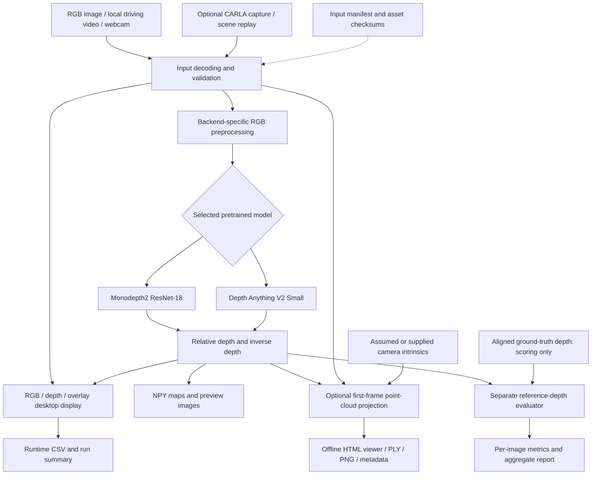

# Monocular Depth Estimation

A final-year computer vision project that estimates **relative scene depth from a single RGB image or successive video frames**. The application integrates pretrained neural networks, a desktop visualization, optional point-cloud export, runtime profiling and reproducible evaluation.

**Current delivery:** image and recorded driving-video inference have been demonstrated locally. On 24 October 2026, both backends passed all eight delivery checks and 60-second displayed rehearsals on the RTX 4050 laptop; see [new-laptop validation](docs/new_laptop_validation.md) for measurements and limits. Physical webcam validation and rehearsals on any other presentation laptop remain separate acceptance steps. Outputs indicate relative near/far structure; they are not calibrated distances or vehicle-control commands.

## Features

- **Two pretrained backends:** Monodepth2 ResNet-18 as the default baseline and Depth Anything V2 Small as an optional comparison model.
- **Multiple inputs:** individual images, local video and webcam capture; optional CARLA capture and stored-scene replay tools.
- **Desktop visualization:** synchronized RGB, relative inverse-depth colour map and depth overlay, with the selected model, device and completed FPS.
- **Portable driving demo:** checksum-verified video, retained attribution/license, fallback image and input manifest.
- **Numerical exports:** inverse-depth and relative-depth arrays, previews, per-frame timing and run metadata.
- **Optional point cloud:** bounded first-frame coloured point cloud with PLY, PNG, metadata and a self-contained offline HTML viewer.
- **Reproducible checks:** unit/integration tests, prediction-repeatability profiling, reference-depth evaluation and an offline delivery validator.
- **Failure diagnostics:** unexpected video truncation is rejected when a declared frame count is available; demo failures after output creation retain `failure.json` and release capture/display resources.

## System architecture



Ground-truth depth is never an inference input. Supplied camera intrinsics do not resolve the model's unknown depth scale. Recorded driving footage is replayed while depth is computed; this is distinct from a live simulator or physical webcam demonstration.

## Models and preprocessing

| Property | Monodepth2 baseline | Depth Anything V2 Small option |
|---|---|---|
| CLI selector | `--model monodepth2` | `--model depth-anything` |
| Architecture | ResNet-18 encoder and depth decoder | DINOv2 ViT-S encoder and DPT depth head |
| Weights | Official monocular `mono_640x192` checkpoint | Official relative-depth Small checkpoint |
| Input processing | RGB, bilinear resize to 640 × 192; model-internal normalization | RGB, ImageNet normalization, aspect-preserving bicubic resize to multiples of 14 |
| Input-size control | Fixed 640 × 192 | Short-edge target 294 by default; 392 or 518 optional, subject to long-edge budget |
| Output geometry | 192 × 640 arrays | Arrays resized to the supplied RGB geometry |
| Runtime device | CPU or CUDA | CPU or CUDA |

Both models use pretrained weights. **No project-specific training or fine-tuning has been completed.** The optional model is a distinct architecture and must be identified by its actual name in presentations. Source revisions, asset hashes and preprocessing identities are pinned in the implementation and recorded in run metadata.

Video/webcam input is decoded one frame at a time and bounded to 640 × 480 while preserving aspect ratio. Inference uses batch size one and two PyTorch CPU threads. The default video/webcam processing ceiling is 10 FPS; it is not a guaranteed minimum. Sequential replay slows when processing cannot keep up with the original video rate.

## Technology stack

The exact environment is pinned in [requirements.txt](requirements.txt).

| Component | Technology / validated version | Purpose |
|---|---|---|
| Runtime | Python 3.8.20, Windows, PowerShell commands | Validated local execution environment |
| Deep learning | PyTorch 2.0.1 + CUDA 11.8; torchvision 0.15.2 + CUDA 11.8 | Model loading and inference |
| Numerical processing | NumPy 1.24.4 | Depth arrays, geometry and evaluation |
| Image/video I/O | OpenCV 4.8.1.78; Pillow 9.5.0 | Capture, decoding, resizing and images |
| Desktop interface | Pygame 2.5.2 | RGB/depth/overlay presentation |
| Plotting | Matplotlib 3.7.5 | Point-cloud preview export and visualization support |
| Point-cloud viewer | HTML, CSS, JavaScript Canvas 2D | Interactive projection of exported 3D points; no server or frontend build required |
| Verification | Python `unittest`, SHA256 manifests, CSV/JSON reports | Regression tests, provenance and measurements |
| Optional simulation | CARLA client/server 0.9.13 | Sensor capture and replay tooling |
| Optional report generation | ReportLab, Pillow and pypdf in a separate documentation environment | Implementation PDF generation |

The CARLA client is retained in the requirements for compatibility; normal image/video inference does not require a running CARLA server. Open3D supplies the reference sample data but is not an installed inference dependency. The README's architecture diagram uses Mermaid on compatible Markdown viewers.

## Installation

Run commands from the repository root in PowerShell. The documented dependency set targets Python 3.8; do not assume a newer interpreter is interchangeable with these pinned wheels. CPU execution is supported, while CUDA is the demonstrated presentation path. A fresh laptop requires a compatible NVIDIA driver and a newly created environment.

```powershell
git clone https://github.com/pjha26/FinalProject.git
cd FinalProject
py -3.8 -m venv .venv
.\.venv\Scripts\python.exe -m pip install -r requirements.txt
.\.venv\Scripts\python.exe project.py assets
.\.venv\Scripts\python.exe project.py prepare-demo
.\.venv\Scripts\python.exe project.py check --output runs/hardware_check.json
.\.venv\Scripts\python.exe project.py verify-demo
```

Model/source and sample preparation need internet access. Prepared inference runs offline. Inspect `hardware_check.json` for `cuda_available`, the actual GPU and dependency import errors; `check` saves diagnostics rather than certifying readiness. Explicit `--device cuda` fails if CUDA is unavailable; `--device cpu` deliberately uses the CPU.

Install the optional model separately:

```powershell
.\.venv\Scripts\python.exe project.py assets --model depth-anything
```

## Run the demonstration

**Recorded driving video — recommended validated input path:**

```powershell
.\.venv\Scripts\python.exe project.py demo --model monodepth2 --source video --video data/demo/driving.mp4 --manifest data/demo/input_manifest.json --device cuda --frames 650 --fps 10 --min-seconds 60 --review-every 200 --output runs/presentation_video_01
```

Allow the command to finish for the 60-second displayed acceptance gate. Close the window or press Escape to stop; a short run cannot satisfy that gate. Change the output suffix for every new attempt: existing run folders are intentionally never overwritten.

**Single-image fallback:**

```powershell
.\.venv\Scripts\python.exe project.py infer --model monodepth2 --image data/demo/driving_first_frame.png --device cuda --output runs/presentation_image_01
```

**Optional webcam — validate separately before presenting:**

```powershell
.\.venv\Scripts\python.exe project.py demo --source webcam --camera 0 --device cuda --frames 650 --fps 10 --min-seconds 60 --output runs/presentation_camera_01
```

The physical camera-index-0 probe failed on the development laptop. Check Windows camera permissions, available indices and competing camera applications before relying on this input. If unavailable, explicitly demonstrate the recorded-video mode instead.

**Optional model:** append `--model depth-anything --input-size 294` in place of the baseline model selection. Use separate output directories and retain the baseline as a rehearsed fallback. Larger input settings have not established better driving accuracy.

**Optional point cloud:** add `--point-cloud` to `infer` or `demo`. Open the output folder's `point_cloud/viewer.html` in a browser to rotate and zoom. The export represents the first processed frame, contains at most 10,000 RGB-coloured points, excludes invalid/floor and distant outlier predictions, and records its filtering in metadata. It is a qualitative relative surface projection with assumed/provided intrinsics, not a live 3D stream, LiDAR measurement or complete reconstruction.

## Interpreting outputs

The left panel shows RGB, the centre shows relative inverse depth, and the right blends 70% depth colour with 30% RGB. Yellow indicates relatively nearer regions and purple relatively farther regions. Colours use a fixed logarithmic display scale; they do not directly encode metres or guarantee accuracy.

| Output | Description |
|---|---|
| `preview.png` | First-frame RGB/depth/overlay composite with model identity |
| `inverse_depth.npy`, `relative_depth.npy` | First-frame numerical predictions; positive, uncalibrated relative values |
| `summary.json` | Completed demo evidence: selected backend/device, frame count, completed FPS, timing statistics, memory and optional cloud paths |
| `runtime.csv` | Model, processing, capture-to-display and full-cycle time for each completed frame |
| `metrics.json` | Demo GT scores only where compatible reference depth exists; empty for ordinary RGB-only video/webcam |
| `review.json`, review snapshots | Optional first, periodic adjacent and final frame exports for qualitative inspection |
| `point_cloud/` | Optional PLY, offline viewer, preview and geometry metadata |
| `failure.json` | Failure/interruption diagnostic after demo output creation, with error and completed-frame count; partial outputs are not accepted results |

Image inference has a smaller summary containing its own processing/model latency and model metadata. A demo failure can leave partial files; inspect `failure.json`, the terminal and any saved duration gate before treating a run as complete. Validation errors before output creation are reported in the terminal. Lack of a reliable declared video frame count limits detection of premature decoding stops.

## Validation and measured results

Run the automated suite:

```powershell
.\.venv\Scripts\python.exe -m unittest discover -s tests -v
```

Prepare the small paired reference dataset, then perform offline integrated acceptance on the actual presentation laptop:

```powershell
.\.venv\Scripts\python.exe project.py prepare-reference-eval
.\.venv\Scripts\python.exe tools/validate_delivery.py --device cuda --model monodepth2 --display
```

The delivery validator runs tests, input verification, environment diagnostics, image inference, repeated profiling, reference evaluation, headless video and a displayed rehearsal. It performs no downloads, freezes source hashes, retains per-step logs and stops on failure. Check that the final `summary.json` has `status: pass` and `displayed_rehearsal: pass`. Use `--model depth-anything --input-size 294` for a separate optional-model acceptance run. Omit `--display` only when intentionally leaving displayed acceptance pending.

Measured local observations on 21 October 2026:

| Workload | Device | Observed result | Scope |
|---|---|---|---|
| Monodepth2, 30 measured frames/repeat, two repeats | CPU, two threads | 1.57 / 1.56 FPS; 578.29 ms median model time | Headless pipeline; excludes setup/warmup |
| Monodepth2, 650-frame driving replay, 30 FPS ceiling | GTX 1650 4 GB | 9.96 FPS over 65.27 s; 28.49 ms median model time | Displayed pipeline, with optional first-frame cloud and periodic exports |
| Monodepth2, reliability rehearsal, 650 frames, 10 FPS ceiling | GTX 1650 4 GB | 9.10 FPS over 71.42 s; displayed duration gate passed | Current reliability update; periodic review exports, no cloud |
| Depth Anything V2 Small-294, reliability rehearsal, 650 frames, 10 FPS ceiling | GTX 1650 4 GB | 8.37 FPS over 77.66 s; displayed duration gate passed | Periodic review exports and a 10,000-point first-frame cloud |
| Depth Anything V2 Small-294, five indoor reference frames | GTX 1650 | AbsRel 0.2033 versus baseline 0.4960 | Small GT-median-aligned diagnostic; not a driving benchmark |

These are observations, not hardware guarantees or controlled comparisons between unlike workloads. Earlier run history is retained in the phase documents and reports. Source clip rate, CPU processing, rendering, exports, pacing and system load affect completed FPS. GPU model latency alone is not displayed throughput. The RTX 3050 remains untested; RTX 4050 results are recorded separately in the [24 October validation](docs/new_laptop_validation.md); **14–20 FPS on CPU is not an established project result**.

The reliability update passed **87 automated tests and all eight baseline delivery checks**, with unchanged source during validation. The local evidence is retained in ignored `runs/presentation_reliability_delivery_01/`; a fresh clone must produce its own run evidence. Software acceptance on this development laptop does not replace the presentation-machine rehearsal.

The optional backend's separate displayed rehearsal also passed, including point-cloud export (`runs/presentation_reliability_quality_01/`). These two rehearsals establish integration and duration acceptance; neither supplies driving-depth accuracy ground truth.

The five reference frames are correlated indoor samples from Open3D/Redwood. GT median alignment uses information unavailable during deployment; aligned errors do not establish calibrated output distances. The driving sample has no aligned GT. Read the [evaluation protocol](docs/evaluation_protocol.md), [accuracy report](docs/accuracy_report.md) and [poster alignment review](docs/poster_alignment.md) before reporting performance or accuracy.

## KITTI cropped-validation pilot

A local KITTI validation pilot is now implemented and measured: **24 images from eight drives**, excluding drives in the pinned Monodepth2 Eigen-Zhou training/development lists. Depth Anything's pretraining overlap is unknown. The importer reads the supplied ZIP directly, keeps only the selected paired RGB/depth/intrinsics, converts KITTI depth using `/256`, freezes checksums, and rejects invalid inputs or existing output directories. **92 tests passed**, and both models completed all 24 examples.

| Backend | AbsRel | GT-aligned RMSE (m) | Delta1 |
|---|---:|---:|---:|
| Monodepth2 ResNet-18 | 0.093627 | 4.219610 | 0.912854 |
| Depth Anything V2 Small-294 | 0.094203 | 4.258988 | 0.927902 |

This is a small **cropped-validation diagnostic**, not an official KITTI/Eigen benchmark or evidence of completed fine-tuning. Scores use per-image GT median alignment; deployment outputs remain relative. The mixed metrics do not establish a universal model winner. Read the [KITTI pilot guide and full results](docs/kitti_pilot.md) for selection, split overlap, masks, provenance and all metrics.

```powershell
.\.venv\Scripts\python.exe tools/prepare_kitti_subset.py --archive 'C:\path\to\data_depth_selection.zip' --output data/evaluation/kitti_pilot_01
.\.venv\Scripts\python.exe project.py evaluate --manifest data/evaluation/kitti_pilot_01/evaluation_manifest.json --model monodepth2 --device cuda --output runs/kitti_baseline_01
.\.venv\Scripts\python.exe project.py evaluate --manifest data/evaluation/kitti_pilot_01/evaluation_manifest.json --model depth-anything --input-size 294 --device cuda --output runs/kitti_small_01
```

Use fresh output paths on a repeat. Keep the ZIP, prepared data and raw run evidence outside Git. The validation subset must not become fine-tuning data.

## Temporal training-data preparation

A tested [CARLA triplet preparation tool](docs/carla_training_pilot.md) now groups audited captures into RGB-only previous/current/next inputs, with camera calibration, stationary-triplet rejection, image hashes and disjoint train/validation maps. The full suite passes 99 tests. CARLA clients now use the project-local map cache, fixing the observed home-directory write failure, and capture commands accept an explicit `--timeout` while preserving the 15-second default. Synthetic fixture tests establish preparation behavior; native camera capture and actual fine-tuning still require separate acceptance.

## Driving-scene improvement roadmap

Follow the [driving validation and presentation plan](docs/driving_validation.md) for the next work:

1. Freeze the current baseline and reproduce a complete rehearsal on the presentation laptop, including an offline run and saved-image fallback.
2. Compare both existing models on the same varied, permitted driving clips; review vehicles, boundaries, road/horizon, shadows and reflective surfaces using saved snapshots.
3. Extend the initial 24-image KITTI cropped-validation pilot with broader documented evaluation and an untouched test split. Retain the same masks/crop/scaling protocol and check pretraining overlap; a full Eigen benchmark remains separate.
4. Investigate the largest measured errors before considering fine-tuning, new models or deployment optimizations. Accept changes only after repeatable quality and runtime checks.

## Presentation laptop handoff

- Transfer the same Git revision. Rebuild `.venv`; do not copy another machine's virtual environment.
- Prepare online or separately copy ignored `third_party/monodepth2/`, `checkpoints/baseline_mono_640x192/`, `data/demo/` and `data/evaluation/redwood/`, keeping licenses and manifests. For the optional backend, also include `third_party/depth_anything_v2/` and `checkpoints/depth_anything_v2_small/`.
- Run input verification and the displayed delivery validator. Keep each machine's evidence separate and rehearse without internet.
- Use a rehearsed model and clip, plug in the laptop, and close unneeded applications after saving work. Keep the single-image command and previously generated outputs available as explicitly labelled fallbacks.

See the [demo and handoff guide](docs/demo_guide.md) for detailed procedures.

## Troubleshooting

| Symptom | Action |
|---|---|
| Output directory already exists | Select a new output suffix; preserve the previous evidence. |
| CUDA unavailable | Inspect `project.py check` output and the driver/environment. CPU is a slower diagnostic fallback; it does not satisfy an unmeasured GPU claim. |
| Video cannot open or ends unexpectedly | Run `verify-demo` for the pinned sample. For custom clips, verify the local file/codec or replace it with a rehearsed decodable copy. |
| Camera cannot open | Check OS permissions, camera index and competing apps; use the recorded-video path if not validated. |
| FPS remains near 10 | Check the configured `--fps` ceiling. For an independent speed test use `--fps 30` in a fresh run; inspect actual `processed_fps`, not the requested ceiling. |
| Depth or point-cloud boundaries look wrong | Inspect raw predictions and scene conditions. A new colour map cannot fix model error or recover metric scale. |
| Plot export cannot write its font cache | Set `$env:MPLCONFIGDIR = "$PWD\.cache\matplotlib"` before execution. |
| A run fails or is interrupted | Read the terminal, `failure.json` if created, and validator logs. Retain partial outputs for diagnosis and rerun into a fresh folder after fixing the cause. |

## Repository structure

```text
project.py                 Command-line entry point and shared inference/demo workflow
requirements.txt           Pinned runtime dependencies
src/                       Model backends, preprocessing, visualization, geometry,
                           evaluation, profiling, input verification and CARLA tools
tests/                     Automated regression and integration checks
tools/validate_delivery.py Offline acceptance workflow and evidence collection
tools/compare_accuracy.py  Reproducible model/input-size comparison
tools/build_implementation_report.py  Optional PDF report generator
docs/                      Demo guide, protocols, accuracy and poster reviews
phases/                    Five phase-specific implementation plans
IMPLEMENTATION_PLAN.md     Overall implementation plan
output/pdf/                Generated implementation report
checkpoints/               Ignored pretrained weights and manifests
third_party/               Ignored pinned upstream inference source and licenses
data/                      Ignored demo and evaluation assets
runs/                      Ignored predictions, logs, measurements and diagnostics
```

## Scope and limitations

This is a pretrained-model integration and evaluation project. It does not currently deliver calibrated metre-scale depth, object detection/tracking, collision warnings, vehicle control, SLAM, validated night/weather robustness or a full driving-depth benchmark. Physical webcam, native CARLA sensor capture and other-laptop acceptance remain incomplete. A website is not required to run the desktop demonstration.

The implementation history is recorded in the [master plan](IMPLEMENTATION_PLAN.md), [Phase 1](phases/phase_01_foundation/implementation.md), [Phase 2](phases/phase_02_data/implementation.md), [Phase 3](phases/phase_03_training/implementation.md), [Phase 4](phases/phase_04_evaluation/implementation.md) and [Phase 5](phases/phase_05_delivery/implementation.md). The [implementation PDF](output/pdf/implementation_progress_report.pdf) is a dated artifact; later changes are documented in source and the current guides.

## Attribution and external assets

- [Monodepth2 — Niantic](https://github.com/nianticlabs/monodepth2): original baseline implementation and pretrained weights; pinned revision `b017a8164fae339b0ce01f3a9e5048104d5abd0e`. Retain its upstream license and weight terms.
- [Depth Anything V2](https://github.com/DepthAnything/Depth-Anything-V2): optional Small model; source and checkpoint revisions/checksums are pinned in `src/depth_anything.py`. The integrated Small assets retain their Apache-2.0 license.
- [Udacity Advanced Lane Lines sample](https://github.com/udacity/CarND-Advanced-Lane-Lines): recorded driving video, pinned revision and checksums, with the MIT license retained in prepared data.
- [Open3D sample data](https://github.com/isl-org/open3d_downloads): five-frame Redwood RGB-D diagnostic; source, archive hash and unit conversion recorded in its manifest and evaluation protocol.
- [KITTI depth prediction benchmark](https://www.cvlibs.net/datasets/kitti/eval_depth.php?benchmark=depth_prediction): source for the local 24-image cropped-validation pilot; full official benchmark evaluation remains pending.
- [CARLA](https://github.com/carla-simulator/carla): optional simulator tooling.
- [SemanticDepth](https://github.com/pablopalafox/semantic-depth): conceptual reference supplied for the project; not the selected inference backend.

Downloaded datasets, model weights, upstream source and local run evidence are excluded from Git. Their respective licenses and provenance must accompany any offline asset handoff. This repository does not grant a new license over third-party assets.
