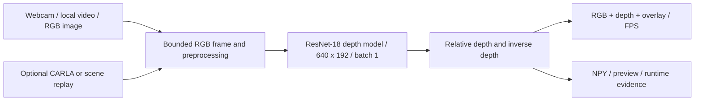

# Real-Time Monocular Depth Estimation

Hardware-friendly final-year prototype: RGB camera or local driving video -> Monodepth2 baseline or Depth Anything V2 Small quality option -> relative depth -> RGB/depth/overlay display and measured FPS.

The user's updated scope replaces the PDF constraints. The default workflow targets GTX 1650 to RTX 3050 laptops with 4 GB VRAM and 8-16 GB RAM. CARLA is optional. Its server failed during earlier sensor attempts on the current 8 GB PC; changing the input source removes that simulator memory requirement.

## Current implementation

- Official monocular `mono_640x192` ResNet-18 checkpoint; checksum-checked, pinned upstream source. Existing image inference ran on the local GTX 1650.
- Shared 640x192, batch-one model inference. One-frame webcam/video decoding, display input bounded to 640x480, two PyTorch CPU threads and a default 10 FPS workload ceiling.
- Webcam is the default demo source. Local video, saved-image inference and the previous optional CARLA/scene-replay commands remain available.
- RGB, relative depth and overlay; first-frame preview and numerical arrays; per-frame runtime CSV and JSON summary. Escape/close releases camera/window. Local video finishes normally at EOF.
- The current display uses a fixed logarithmic inverse-depth colour scale over the model's 0.01-10 range, a near/far legend and a stronger overlay (30% RGB / 70% depth colour). The same numerical value keeps the same colour across frames; there is no per-frame contrast rescaling. This changes visualization only, without changing depth arrays, model weights or accuracy. Original Phase 3-5 measurements and the published implementation report describe the earlier display.
- No GT scores invented for camera/video. Output depth is relative, not calibrated metres. KITTI-trained monocular weights can perform poorly on indoor webcam scenes.
- Resource and model tests are described below. A video fixture validates the pipeline; a physical-camera rehearsal and the friend's RTX 3050 must be checked separately.

## Setup

For improved depth estimates, the optional **Depth Anything V2 Small** backend is now available through the same inference, profiling, evaluation and demo commands. Install its pinned assets with `project.py assets --model depth-anything`, then add `--model depth-anything --input-size 294` to your demo. Existing commands keep the original baseline. See the [accuracy investigation and comparison](docs/accuracy_report.md) for bug fixes, model provenance, measured scope and reproduction commands. The new backend uses its own official preprocessing and native output geometry; it does not reinterpret the old checkpoint.

Measured locally: the Small-294 option reduced AbsRel from **0.4960 to 0.2033** on the existing five-frame indoor diagnostic using the same GT mask and median alignment. This limited diagnostic is not driving benchmark accuracy. **74 tests and all eight quality-backend integration checks passed**; the final displayed replay ran **650 frames in 67.99 seconds at 9.56 FPS** under a 10 FPS cap. The original baseline also passed its software checks. Logs are local under `runs/accuracy_quality_final/`, `runs/accuracy_baseline_delivery/` and `runs/accuracy_comparison_01/`. Independent multi-scene accuracy and RTX 3050 testing remain pending.

For the final presentation, use the [demo and laptop handoff guide](docs/demo_guide.md). After preparing all assets and installing dependencies, run the combined checks with:

```powershell
.\.venv\Scripts\python.exe tools/validate_delivery.py --device cuda --display
```

This runs the full regression suite and the existing Phase 1-4 commands sequentially, including a displayed rehearsal of at least 60 seconds. It performs no downloads. Fresh timestamped outputs, logs, source hashes and a fail-fast summary make the phase handoff reviewable; without `--display`, the display gate remains pending. The five-pair evaluation assets must be prepared with `project.py prepare-reference-eval` or copied as described in the guide. Presentation-machine acceptance is separate from local acceptance.

**Final local acceptance, 19 October 2026:** all **61 tests** and all eight integrated checks passed in a separately rebuilt Python 3.8.20 environment. Actual CUDA image/video inference, exact repeated predictions and the five-pair diagnostic passed with the original checkpoint. The displayed rehearsal processed **650 frames in 82.55 seconds (7.87 FPS under a 10 FPS cap)** and passed the 60-second gate. Peak process working set was **540.00 MiB**; PyTorch peak allocated GPU memory was **106.34 MiB**, excluding other system/driver memory. The source hash inventory and complete evidence remain local in `runs/phase5_delivery/`. This is driving-video replay; RTX 3050, physical webcam and native CARLA remain unverified.

**Visualization follow-up, 19 October 2026:** all **63 tests and eight integrated checks passed** with the clearer log-colour view and legend. The displayed replay completed 650 frames in 71.80 seconds (9.05 FPS under a 10 FPS cap); this separate observation is not a controlled speed comparison. Saved image depth arrays, all profiled prediction fingerprints and all seven diagnostic accuracy scores match the original Phase 5 run exactly. Evidence is local in `runs/visualization_delivery_01/`; the same-prediction before/after preview is in `runs/visualization_comparison/`. This is a readability improvement, without an accuracy gain or replacement-model validation.

The current machine already has `.venv`, dependencies, official weights and source. On another laptop install Python 3.8.20 and a suitable NVIDIA driver, then create a new environment:

```powershell
py -3.8 -m venv .venv
.\.venv\Scripts\python.exe -m pip install -r requirements.txt
.\.venv\Scripts\python.exe project.py assets
.\.venv\Scripts\python.exe project.py check --output runs/hardware_check.json
```

The pinned PyTorch wheels include CUDA 11.8 runtime libraries; no separate toolkit is required for inference. `requirements.txt` retains optional CARLA client tooling for compatibility, but camera/video inference needs no CARLA installation/server. Rebuild `.venv` on your friend's laptop; don't copy the environment folder. Source and model downloads require Internet during setup; prepared inference runs locally.

## Phase 2: repeatable real driving input and laptop transfer

Develop on the current PC and rehearse on the presentation laptop. Keep the same source, model weights, input and preprocessing on both; rebuild the environment on each machine and measure performance separately.

Prepare the approximately 24 MiB [Udacity driving sample](https://github.com/udacity/CarND-Advanced-Lane-Lines). Its repository license is MIT; the preparation command retains the license and pins the source revision and file hashes. No CARLA server is needed:

```powershell
.\.venv\Scripts\python.exe project.py prepare-demo
.\.venv\Scripts\python.exe project.py verify-demo
```

Preparation creates ignored local `data/demo/driving.mp4`, `UDACITY_LICENSE.txt`, `driving_first_frame.png`, and `input_manifest.json`. The real clip has 1,260 decoded frames, 1280x720 resolution, 25 FPS and 50.4 seconds of source footage. The portable manifest records source/license identity, decoded dimensions/count/rate, preprocessing, and baseline weight hashes. Re-running preparation verifies the existing manifest rather than replacing accepted inputs. Modified media, fallback images, model weights or incompatible metadata are rejected.

For the practical rehearsal, use the manifest with the shared demo:

```powershell
.\.venv\Scripts\python.exe project.py demo --source video --video data/demo/driving.mp4 --manifest data/demo/input_manifest.json --device cuda --frames 600 --fps 10 --output runs/driving_rehearsal_01
.\.venv\Scripts\python.exe project.py infer --image data/demo/driving_first_frame.png --device cuda --output runs/driving_image_fallback_01
```

The demo validates the clip before opening its window and records the manifest SHA256 in the run summary. This sample is video replay with live depth computation, not an interactive simulator, and has no ground-truth depth. At a 10 FPS ceiling, 600 sequential frames take at least 60 seconds and cover 24 seconds of the original 25 FPS footage; replay slows rather than skipping frames. Verification/startup time is separate from the summary's processing wall time.

To move to your friend's laptop:

1. Use the same published commit on both laptops, or transfer the current source (`project.py`, `requirements.txt`, `src/`, and `tests/`). Separately transfer `checkpoints/baseline_mono_640x192/`, `third_party/monodepth2/`, and `data/demo/`, which are ignored by Git. Keep licenses/provenance manifests with the assets.
2. Rebuild `.venv` using the setup commands. Do not copy `.venv`, `.runtime`, or `.cache`. Alternatively, with the updated source and Internet access, run `project.py assets` and `project.py prepare-demo` to obtain matching assets.
3. Run `project.py check --output runs/friend_hardware.json`, `project.py verify-demo`, and the regression suite. Confirm CUDA is available, then run the same displayed rehearsal with a fresh output folder.
4. Keep the laptop plugged in; verify a full minute of stable display. Use `--fps 5` if necessary. Retain each laptop's summary/runtime evidence separately and test webcam permissions independently if using that input.

Phase 2 local validation and remaining presentation-machine gates are recorded in the [Phase 2 plan](phases/phase_02_data/implementation.md). GT evaluation and any project-specific training remain separate later work.

On 14 October, all **39 regression checks passed**. A displayed real-video CUDA rehearsal on this 8 GB / GTX 1650 PC processed **350 frames in 71.58 seconds**, at **4.89 FPS under a 5 FPS cap**. Peak process working-set RAM was **620.13 MiB** and PyTorch peak allocated GPU memory **106.34 MiB**; these are not total system RAM or total VRAM. The 350 sequential frames cover 14 source seconds at the original 25 FPS. Evidence is local in `runs/phase2_real_driving_rehearsal/`. To reproduce the accepted workload, use the manifest-based command above with `--frames 350 --fps 5` and a new output directory. The friend's laptop and physical webcam remain unverified.

## Phase 3: profiling and stability

The selected model remains the original pretrained ResNet-18 baseline. Phase 3 adds a repeatable, warmup-aware diagnostic without changing weights, input normalization or the existing image/demo commands:

```powershell
.\.venv\Scripts\python.exe project.py profile --device cuda --frames 60 --warmup 5 --repeats 2 --output runs/profile_review_01
```

This verifies the prepared input/checkpoint pair and profiles the same frames repeatedly in evaluation/inference mode, without a window or FPS cap. Outputs are `summary.json`, `runtime.csv`, `fingerprints.json` and `preview.png`. Timings separate decoding, model execution, complete inference processing, rendering, numerical validation and total headless cycle. Each timing has mean/median/p95/min/max; processing includes model time, so those values overlap. Warmup covers rendering as well as inference.

Every prediction must be finite, positive float32 at 192x640, with reciprocal depth/inverse-depth values. Exact fingerprint mismatches across repeats produce `needs_review` and a failing exit. This checks same-machine numerical repeatability, not accuracy or cross-GPU bit-for-bit equality.

Measured on 18 October, local GTX 1650: **15.75 / 16.00 FPS uncapped headless** across two 60-frame repeats, excluding five warmup frames each; median model **22.40 ms**, rendering **22.52 ms** and full headless cycle **61.30 ms**. Predictions matched between repeats and before/after the rendering optimization. The final profile excludes display, pacing, setup and output writes; it does not establish sustained 10+ FPS for the displayed live/simulator application.

Profiling found rendering overhead. Cached palette/font/static labels and OpenCV overlay blending reduced a separate warmed rendering check from **55.06 to 31.49 ms median** over 20 measured calls. The palette and numerical depth maps are preserved; blend rounding can differ by one colour level. No new application dependencies. **45 regression tests passed**, followed by fresh CUDA image and displayed video smoke checks. Detailed evidence/limitations are in the [Phase 3 handoff](phases/phase_03_training/implementation.md).

The [implementation progress PDF](output/pdf/implementation_progress_report.pdf) records the implementation phases, architecture, model provenance, validation, measured performance, transfer commands and outstanding work. Regenerate it using a documentation Python containing ReportLab, Pillow and pypdf:

```powershell
python tools/build_implementation_report.py --report-date 2026-10-19 --delivery runs/phase5_delivery
```

The generator reads local ignored evidence under `runs/` and `data/`; a fresh clone must first produce/copy those reports. PDF libraries are separate from the pinned inference environment. Fine-tuning, full GT benchmarks, native CARLA, physical webcam and RTX 3050 testing remain pending. The user authorized publishing the Phase 3 update to GitHub in no more than three commits.

## Phase 4: evaluation evidence

The fixed [evaluation protocol](docs/evaluation_protocol.md) separates paired reference-depth diagnostics from RGB-only driving-video demonstrations. The selected pretrained model is unchanged; ground truth is used only for scoring.

```powershell
.\.venv\Scripts\python.exe project.py prepare-reference-eval
.\.venv\Scripts\python.exe project.py evaluate --device cuda --output runs/reference_evaluation_01
```

Preparation downloads a checksum-pinned, approximately 3.6 MiB Open3D RGB-D sample archive without installing Open3D. It converts the documented millimetre depth PNGs into metre-valued float32 arrays and freezes RGB/depth/checkpoint hashes. The five correlated indoor frames from one scene are a **small diagnostic set**, not a KITTI or NYU benchmark. Evaluation checks units, alignment, asset identity, valid masks, inverse-depth interpolation, per-image median alignment and equal-image metric aggregation. Failed runs are marked partial without aggregate scores. Numerical predictions remain relative; aligned errors do not recover deployment-time metric scale.

The local diagnostic evaluated 5 frames / 1,340,711 valid pixels: mean **AbsRel 0.4960**, **SqRel 1.1006**, **RMSE 1.4404 m after GT alignment**, **log RMSE 0.5071**, and **delta1/2/3 0.3763 / 0.6680 / 0.8449**. This substantial indoor error is a limitation, not evidence that driving accuracy targets were achieved. Source/protocol, sample counts and individual results are retained in ignored `data/evaluation/redwood/` and `runs/phase4_reference_evaluation/`.

For displayed runtime and qualitative review:

```powershell
.\.venv\Scripts\python.exe project.py demo --source video --video data/demo/driving.mp4 --manifest data/demo/input_manifest.json --device cuda --frames 650 --fps 10 --min-seconds 60 --review-every 200 --output runs/driving_evaluation_01
```

`--min-seconds` requires a display-enabled frame loop lasting at least the chosen duration. Short runs save `needs_review` and fail; `--headless` cannot satisfy the gate. Optional review exports save first, periodic adjacent and last RGB/inverse-depth/preview frames, indexed by `review.json`. The runtime summary adds mean/median/p95 timings, memory scope, configured cap and explicit acceptance status. Existing commands remain compatible when these flags are omitted.

The first local Phase 4 rehearsal passed: **650 frames / 76.26 seconds / 8.52 FPS under a 10 FPS cap**, with 9 review snapshots. This clip has no GT; its accuracy remains unavailable. Adjacent pairs 200/201 and 600/601 show broad road-to-horizon structure with coarse vehicle boundaries; motion prevents treating those snapshots as a quantitative flicker measure. The [Phase 4 handoff](phases/phase_04_evaluation/implementation.md) records the full-clip run, all validation evidence and remaining acceptance gates. Publishing this phase is authorized as exactly three commits.

A second, higher-cap displayed run processed the **full 1,260-frame clip in 71.40 seconds at 17.65 FPS**, with `--fps 30 --min-seconds 60 --review-every 400`. The effective cap is the source's 25 FPS, and playback remains slower than native source speed. This observed local result is not a webcam/CARLA or RTX 3050 guarantee. Peak process working set was **734.73 MiB**, PyTorch allocated peak **106.34 MiB**; total system/driver peaks were not recorded. **All 55 regression tests passed.** Full KITTI/CARLA accuracy, fine-tuning, calibrated metric scale and remaining hardware gates stay pending.

## Run the practical demo

From this project folder in PowerShell:

```powershell
# Webcam: default camera index 0, around 60 seconds at the 10 FPS ceiling
.\.venv\Scripts\python.exe project.py demo --source webcam --camera 0 --device cuda --frames 600 --fps 10 --output runs/review_webcam_01

# Driving footage: prepared with project.py prepare-demo, or supplied locally
.\.venv\Scripts\python.exe project.py demo --source video --video data/demo/driving.mp4 --device cuda --frames 300 --fps 10 --output runs/review_video_01

# Verified single-image fallback
.\.venv\Scripts\python.exe project.py infer --image data/fixtures/test_image.jpg --device cuda --output runs/review_image_01
```

Close the window or press **Escape** to stop. Use a different output directory each time: existing runs are intentionally never overwritten. Camera access requires Windows camera permission and an available device; try `--camera 1` if the intended device is not index 0. The driving video is downloaded by `prepare-demo`, not stored in Git. A video is processed sequentially, capped at its native FPS and --fps; processing below that rate slows replay rather than dropping frames.

If the laptop struggles, use `--fps 5`, close unused apps after saving your work, and keep CARLA stopped. `--device cpu` is a slower fallback. `--headless` omits the window for automated tests. A 10 FPS cap is a ceiling, not a promised minimum.

Demo outputs:

| File | Meaning |
|---|---|
| `preview.png` | First processed frame: RGB / relative depth / overlay |
| `inverse_depth.npy`, `relative_depth.npy` | First-frame numerical model outputs, 192x640, uncalibrated scale |
| `runtime.csv` | Per-frame model, processing, arrival-to-display and full-cycle timing |
| `summary.json` | Source, checkpoint, device, frame count, wall time, observed FPS, input rate and PyTorch peak allocated GPU bytes |
| `metrics.json` | Empty when no GT exists; diagnostic GT-aligned results for compatible recorded scenes |

Timing includes first-frame overhead; the displayed FPS uses already-completed frames. The summary is the completed run measurement. PyTorch allocated GPU memory excludes driver/runtime/other applications; inspect total VRAM and RAM in Task Manager as well. Outputs, camera footage, weights and downloaded runtimes stay ignored by Git.

## Architecture and phase transitions



The [master plan](IMPLEMENTATION_PLAN.md) and [Phase 1](phases/phase_01_foundation/implementation.md), [Phase 2](phases/phase_02_data/implementation.md), [Phase 3](phases/phase_03_training/implementation.md), [Phase 4](phases/phase_04_evaluation/implementation.md), [Phase 5](phases/phase_05_delivery/implementation.md) now use the revised hardware scope. Baseline hashes, preprocessing, prediction shapes and existing CLI commands remain the handoff contracts. Later model experiments use separate checkpoints and must pass the working demo gate before adoption.

## Verification and remaining work

```powershell
.\.venv\Scripts\python.exe -m unittest discover -s tests -v
```

Tests cover RGB ordering/resizing, numerical metrics and geometry, source/checkpoint safety, scene replay, camera release and input failure, local video decoding/EOF, demo outputs, and actual checkpoint repeatability where assets are present. A mocked webcam does not prove physical-camera operation.

Local validation on 13 October 2026: **33 regression checks passed**. The actual checkpoint processed a 100-frame synthetic driving-image clip on the GTX 1650: **8.33 FPS headless** at a 10 FPS ceiling, **25.21 ms median model time**, **685.86 MiB peak process working-set RAM**, and **106.34 MiB peak PyTorch allocated GPU memory**. A separate displayed 30-frame run completed at **6.98 FPS**, including startup overhead. These short synthetic runs validate integration, not real driving quality or a 60-second live rehearsal. Evidence is local under `runs/lightweight_video_validation/` and `runs/lightweight_display_validation/`.

The physical webcam attempt at camera index 0 failed to open; permission/device availability is unresolved. No full KITTI/NYU accuracy benchmark, new project-trained weights or successful native CARLA sensor pilot has been completed. The RTX 3050 laptop has not been measured. Rehearse a real webcam or permitted driving clip for at least 60 seconds on the presentation laptop before using it for assessment.

## Optional simulator tools

These existing commands remain available for a suitable machine; they are not needed for the new default demo:

```powershell
.\.venv\Scripts\python.exe project.py check --carla --host 127.0.0.1 --port 2000 --output runs/carla_check.json
.\.venv\Scripts\python.exe project.py install-server
.\.venv\Scripts\python.exe project.py collect --map Town04 --frames 100 --output data/carla/scenes/pilot_new
.\.venv\Scripts\python.exe project.py demo --source carla --map Town04 --frames 100 --output runs/carla_new
.\.venv\Scripts\python.exe project.py demo --source replay --scene data/carla/scenes/valid_scene --frames 100 --output runs/replay_new
.\.venv\Scripts\python.exe project.py audit-scene --scene data/carla/scenes/valid_scene --output runs/scene_audit.json
.\.venv\Scripts\python.exe project.py calibrate-depth --map Town04 --output runs/depth_geometry.json
```

The native simulator must be started separately for live capture. Existing failed zero-frame scene folders are partial and rejected by replay. Geometry/audit unit tests do not replace real sensor validation. Do not restart CARLA on the memory-constrained PC just to run webcam/video depth.

## References and Git

Model implementation/pretrained assets: [official Monodepth2](https://github.com/nianticlabs/monodepth2), pinned source revision `b017a8164fae339b0ce01f3a9e5048104d5abd0e`. Original license remains in the downloaded source. Conceptual reference: [SemanticDepth](https://github.com/pablopalafox/semantic-depth). [Lite-Mono](https://github.com/noahzn/Lite-Mono) is a possible later smaller-model experiment, not a currently supported checkpoint architecture.

Phases 1-4 are published. The user authorizes Phase 5 delivery changes in exactly three commits to `pjha26/FinalProject`. Keep generated datasets, weights, runtimes and raw run evidence local; transfer required ignored assets separately for an offline demonstration.
