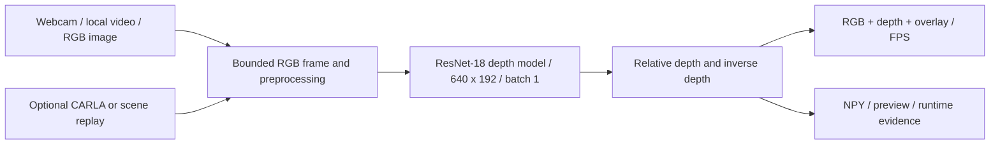

# Real-Time Monocular Depth Estimation

Hardware-friendly final-year prototype: RGB camera or local driving video -> Monodepth2 ResNet-18 -> relative depth -> RGB/depth/overlay display and measured FPS.

The user's updated scope replaces the PDF constraints. The default workflow targets GTX 1650 to RTX 3050 laptops with 4 GB VRAM and 8-16 GB RAM. CARLA is optional. Its server failed during earlier sensor attempts on the current 8 GB PC; changing the input source removes that simulator memory requirement.

## Current implementation

- Official monocular `mono_640x192` ResNet-18 checkpoint; checksum-checked, pinned upstream source. Existing image inference ran on the local GTX 1650.
- Shared 640x192, batch-one model inference. One-frame webcam/video decoding, display input bounded to 640x480, two PyTorch CPU threads and a default 10 FPS workload ceiling.
- Webcam is the default demo source. Local video, saved-image inference and the previous optional CARLA/scene-replay commands remain available.
- RGB, relative depth and overlay; first-frame preview and numerical arrays; per-frame runtime CSV and JSON summary. Escape/close releases camera/window. Local video finishes normally at EOF.
- No GT scores invented for camera/video. Output depth is relative, not calibrated metres. KITTI-trained monocular weights can perform poorly on indoor webcam scenes.
- Resource and model tests are described below. A video fixture validates the pipeline; a physical-camera rehearsal and the friend's RTX 3050 must be checked separately.

## Setup

The current machine already has `.venv`, dependencies, official weights and source. On another laptop install Python 3.8.20 and a suitable NVIDIA driver, then create a new environment:

```powershell
py -3.8 -m venv .venv
.\.venv\Scripts\python.exe -m pip install -r requirements.txt
.\.venv\Scripts\python.exe project.py assets
.\.venv\Scripts\python.exe project.py check --output runs/hardware_check.json
```

The pinned PyTorch wheels include CUDA 11.8 runtime libraries; no separate toolkit is required for inference. `requirements.txt` retains optional CARLA client tooling for compatibility, but camera/video inference needs no CARLA installation/server. Rebuild `.venv` on your friend's laptop; don't copy the environment folder. Source and model downloads require Internet during setup; prepared inference runs locally.

## Run the practical demo

From this project folder in PowerShell:

```powershell
# Webcam: default camera index 0, around 60 seconds at the 10 FPS ceiling
.\.venv\Scripts\python.exe project.py demo --source webcam --camera 0 --device cuda --frames 600 --fps 10 --output runs/review_webcam_01

# Driving footage: replace this example path with a real local clip
.\.venv\Scripts\python.exe project.py demo --source video --video data/demo/driving.mp4 --device cuda --frames 300 --fps 10 --output runs/review_video_01

# Verified single-image fallback
.\.venv\Scripts\python.exe project.py infer --image data/fixtures/test_image.jpg --device cuda --output runs/review_image_01
```

Close the window or press **Escape** to stop. Use a different output directory each time: existing runs are intentionally never overwritten. Camera access requires Windows camera permission and an available device; try `--camera 1` if the intended device is not index 0. The driving video example is not bundled. A video is processed sequentially, capped at its native FPS and --fps; processing below that rate slows replay rather than dropping frames.

If the laptop struggles, use `--fps 5`, close unused apps after saving your work, and keep CARLA stopped. `--device cpu` is a slower fallback. `--headless` omits the window for automated tests. A 10 FPS cap is a ceiling, not a promised minimum.

Demo outputs:

| File | Meaning |
|---|---|
| `preview.png` | First processed frame: RGB / relative depth / overlay |
| `inverse_depth.npy`, `relative_depth.npy` | First-frame numerical model outputs, 192x640, uncalibrated scale |
| `runtime.csv` | Per-frame model, processing, arrival-to-display and full-cycle timing |
| `summary.json` | Source, checkpoint, device, frame count, wall time, observed FPS, input rate and PyTorch peak allocated GPU bytes |
| `metrics.json` | Empty when no GT exists; diagnostic GT-aligned results for compatible recorded scenes |

Timing includes first-frame overhead; the displayed FPS uses already-completed frames. The summary is the completed run measurement. PyTorch allocated GPU memory excludes driver/runtime/other applications; inspect total VRAM and RAM in Task Manager as well. Outputs, camera footage, weights and downloaded runtimes stay ignored by Git.

## Architecture and phase transitions



The [master plan](IMPLEMENTATION_PLAN.md) and [Phase 1](phases/phase_01_foundation/implementation.md), [Phase 2](phases/phase_02_data/implementation.md), [Phase 3](phases/phase_03_training/implementation.md), [Phase 4](phases/phase_04_evaluation/implementation.md), [Phase 5](phases/phase_05_delivery/implementation.md) now use the revised hardware scope. Baseline hashes, preprocessing, prediction shapes and existing CLI commands remain the handoff contracts. Later model experiments use separate checkpoints and must pass the working demo gate before adoption.

## Verification and remaining work

```powershell
.\.venv\Scripts\python.exe -m unittest discover -s tests -v
```

Tests cover RGB ordering/resizing, numerical metrics and geometry, source/checkpoint safety, scene replay, camera release and input failure, local video decoding/EOF, demo outputs, and actual checkpoint repeatability where assets are present. A mocked webcam does not prove physical-camera operation.

Local validation on 13 October 2026: **33 regression checks passed**. The actual checkpoint processed a 100-frame synthetic driving-image clip on the GTX 1650: **8.33 FPS headless** at a 10 FPS ceiling, **25.21 ms median model time**, **685.86 MiB peak process working-set RAM**, and **106.34 MiB peak PyTorch allocated GPU memory**. A separate displayed 30-frame run completed at **6.98 FPS**, including startup overhead. These short synthetic runs validate integration, not real driving quality or a 60-second live rehearsal. Evidence is local under `runs/lightweight_video_validation/` and `runs/lightweight_display_validation/`.

The physical webcam attempt at camera index 0 failed to open; permission/device availability is unresolved. No full KITTI/NYU accuracy benchmark, new project-trained weights or successful native CARLA sensor pilot has been completed. The RTX 3050 laptop has not been measured. Before the 15 October review, rehearse a real webcam or permitted driving clip for 60 seconds on the presentation laptop.

## Optional simulator tools

These existing commands remain available for a suitable machine; they are not needed for the new default demo:

```powershell
.\.venv\Scripts\python.exe project.py check --carla --host 127.0.0.1 --port 2000 --output runs/carla_check.json
.\.venv\Scripts\python.exe project.py install-server
.\.venv\Scripts\python.exe project.py collect --map Town04 --frames 100 --output data/carla/scenes/pilot_new
.\.venv\Scripts\python.exe project.py demo --source carla --map Town04 --frames 100 --output runs/carla_new
.\.venv\Scripts\python.exe project.py demo --source replay --scene data/carla/scenes/valid_scene --frames 100 --output runs/replay_new
.\.venv\Scripts\python.exe project.py audit-scene --scene data/carla/scenes/valid_scene --output runs/scene_audit.json
.\.venv\Scripts\python.exe project.py calibrate-depth --map Town04 --output runs/depth_geometry.json
```

The native simulator must be started separately for live capture. Existing failed zero-frame scene folders are partial and rejected by replay. Geometry/audit unit tests do not replace real sensor validation. Do not restart CARLA on the memory-constrained PC just to run webcam/video depth.

## References and Git

Model implementation/pretrained assets: [official Monodepth2](https://github.com/nianticlabs/monodepth2), pinned source revision `b017a8164fae339b0ce01f3a9e5048104d5abd0e`. Original license remains in the downloaded source. Conceptual reference: [SemanticDepth](https://github.com/pablopalafox/semantic-depth). [Lite-Mono](https://github.com/noahzn/Lite-Mono) is a possible later smaller-model experiment, not a currently supported checkpoint architecture.

The Phase 1 update contains ten source/documentation files, including the six plan files. The user authorized committing and pushing this work to `pjha26/FinalProject` in no more than four Phase 1 commits. Keep generated datasets, weights, runtimes and run evidence local; future publication requires user authorization.
