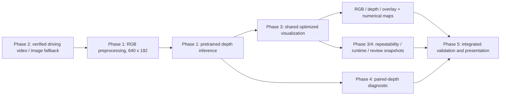

# Final demonstration and laptop handoff

The project estimates **relative depth from RGB alone** using the original pretrained Monodepth2 ResNet-18 baseline or the new Depth Anything V2 Small quality option. The supported practical demonstration is real driving-video replay with depth computed for each frame. It displays RGB, estimated depth, overlay and measured FPS. It is a perception prototype, without vehicle control or calibrated distances.

## Architecture and completed phases



The existing image, webcam, video and optional CARLA/replay commands keep their interfaces. Phase 5 runs those accepted components rather than introducing another inference pipeline.

## Prepare the presentation laptop

1. Clone the published project and use the same commit as the development machine. Install **Python 3.8.20 x64** and a compatible NVIDIA driver. Plug the laptop into power.
2. Rebuild the environment from PowerShell in the project root. Run each line only after the preceding command succeeds:

   ```powershell
   py -3.8 -m venv .venv
   .\.venv\Scripts\python.exe -m pip install -r requirements.txt
   .\.venv\Scripts\python.exe project.py assets
   .\.venv\Scripts\python.exe project.py prepare-demo
   .\.venv\Scripts\python.exe project.py prepare-reference-eval
   ```

3. Complete downloads before the demonstration. Alternatively, copy these **complete folders** from this PC into matching locations after cloning:

   | Folder | Purpose |
   |---|---|
   | `checkpoints/baseline_mono_640x192/` | Original weights and hash manifest |
   | `third_party/monodepth2/` | Pinned model source, provenance and original license |
   | `data/demo/` | Driving clip, image fallback, manifest and Udacity license |
   | `data/fixtures/` | Official saved-image fixture used by the regression suite |
   | `data/evaluation/redwood/` | Frozen five-pair reference data and evaluation manifest |

   Keep all provenance/license files. Do not copy `.venv`, `.runtime`, `.cache`, private camera captures or unfinished CARLA scenes. The weights, media and original run folders are deliberately absent from Git. Transfer desired evidence separately, including its full run directory. Offline inference requires prepared assets and a working environment; first-time installation still needs packages or a separately prepared wheel cache.

4. Validate on **that laptop**, using a fresh output directory:

   ```powershell
   .\.venv\Scripts\python.exe tools/validate_delivery.py --device cuda --display
   ```

   This sequential command runs all regression tests, verifies the driving manifest/checkpoint, checks the environment, predicts an image, repeats a short profile, evaluates the five reference pairs, performs a headless video smoke test and requires at least 60 seconds of displayed video. It uses the interpreter that launches it, makes no downloads and writes timestamped outputs under `runs/`. Use `--output runs/my_delivery_01` to choose an unused directory. Closing the window early fails the displayed gate. Without `--display`, software checks can pass while the display gate remains **pending**.

5. Check the final `summary.json`: `status` and `displayed_rehearsal` should both be `pass`. Inspect `tests.log`, `environment.json`, `profile/summary.json`, `evaluation/summary.json` and `display/summary.json`. A failure stops subsequent steps and preserves logs. Fix the failure and retry into a new directory. Source/requirements hashes must remain unchanged during the run.

On the local GTX 1650, a separate Python 3.8.20 environment was rebuilt from the pinned requirements using the local package cache. The friend's RTX 3050 results must be recorded separately; local measurements do not establish its acceptance.

**Recorded local acceptance (19 October 2026):** `runs/phase5_delivery/summary.json` records all eight steps and displayed acceptance as passing. All 61 regression tests passed; the short profile's predictions matched exactly across repeats; image/video inference and the five-pair evaluator completed. The displayed replay processed 650 frames in 82.55 seconds at 7.87 FPS under a 10 FPS cap. Peak process working set was 540.00 MiB and PyTorch peak GPU allocation was 106.34 MiB; neither measures total system memory. Source hashes were unchanged during validation. This establishes local software acceptance without claiming 10 FPS for this displayed run.

## Run the actual presentation

For the improved model option, first run `project.py assets --model depth-anything` while online, then add `--model depth-anything --input-size 294` to the demo/image commands below and to `tools/validate_delivery.py`. Copy `third_party/depth_anything_v2/` and `checkpoints/depth_anything_v2_small/`, including their licenses/provenance, for an offline handoff. Keep the existing baseline/input folders as well: frozen input manifests retain their original baseline reference, while new run summaries record the actual selected model independently. Follow the [accuracy report](accuracy_report.md) for comparisons and limits. The original commands below remain the Monodepth2 fallback.

Prepare the environment and assets first. Use unused output names; the existing commands refuse to overwrite a run.

```powershell
.\.venv\Scripts\python.exe project.py demo --source video --video data/demo/driving.mp4 --manifest data/demo/input_manifest.json --device cuda --frames 650 --fps 10 --min-seconds 60 --review-every 200 --output runs/presentation_video_01
```

Show the moving RGB view, changing depth map and overlay. The current display uses a fixed logarithmic scale over inverse-depth values 0.01-10, revealing differences that the earlier linear colours made faint. Purple means estimated farther away and yellow means estimated nearer; the legend is relative, without metre units. The overlay is 30% original RGB plus 70% depth colour so predictions are easier to see. The same value retains its colour across frames. Numerical depth predictions and the model are unchanged. Sky, reflective objects and fine boundaries can be inaccurate; the stronger colours may make these errors more obvious. At the 10 FPS cap the 25 FPS source plays more slowly; the measured displayed rate is in `summary.json`, including display-loop work and pacing. This command processes 26 seconds of source footage over at least a minute of wall time.

Press Escape or close the window to stop. For the acceptance run, allow the command to finish; early closure may fail the minimum-duration gate. To repeat, change the output suffix.

**Optional physical webcam**, only after separately checking permissions and camera index:

```powershell
.\.venv\Scripts\python.exe project.py demo --source webcam --camera 0 --device cuda --frames 650 --fps 10 --min-seconds 60 --output runs/presentation_camera_01
```

Move the camera slowly and show changing predictions. Indoor scenes differ from KITTI driving training data. If the camera cannot open, use the accepted video command. Never describe the video fallback as a successful live webcam or CARLA test.

**Saved-image fallback**, if video decoding/display fails:

```powershell
.\.venv\Scripts\python.exe project.py infer --image data/demo/driving_first_frame.png --device cuda --output runs/presentation_image_01
```

Open the resulting `preview.png`. The output also contains numerical inverse-depth and relative-depth arrays. If CUDA is unavailable, repeat into a new directory with `--device cpu` and expect slower processing. Lower `--fps` for video if needed; do not claim a 10 FPS result under a 5 FPS cap.

## A short explanation for the examiner

**Optional poster point cloud:** add `--point-cloud` to the video or image command above. After the first predicted frame, open the output folder's `point_cloud/viewer.html` in a browser. Rotate/zoom with the mouse or the labelled buttons; `cloud.ply`, `preview.png` and `metadata.json` are saved alongside it. This is a static first-frame relative projection, bounded to 10,000 coloured points, using assumed/provided camera intrinsics. It cannot provide metre distances or unseen geometry. Cloud export adds first-frame overhead; the moving RGB/depth/overlay demo continues normally. No additional package is required.

Read the [poster alignment review](poster_alignment.md) before presenting: the poster's CPU speed is not reproduced, the physical webcam remains unvalidated, and result artwork should be replaced by actual outputs or labelled illustrative. If running the optional Depth Anything model, identify it by its actual name rather than calling it Monodepth2. The window title and saved metadata show the selected backend.

“An ordinary camera records colour but does not directly measure distance. My project uses a pretrained monocular depth network to estimate a relative depth map from each RGB frame. I implemented a reproducible, low-memory inference pipeline, verified driving inputs, visualization, profiling and evaluation, then checked the phases together. The demonstration computes depth as the video runs. It supports perception research; it does not control a vehicle or give calibrated distances.”

If asked about contribution, distinguish the pretrained model from your input preparation, integrity checks, integration, visualization optimization, measured validation and handoff tooling. Explain that no project-specific training has been completed.

If asked about accuracy, report the five-frame indoor diagnostic separately: AbsRel about **0.4960**, median-aligned RMSE about **1.4404 m**. These results expose substantial error; they are neither KITTI benchmark scores nor proof of driving accuracy. Ground-truth median alignment is available only for scoring, not deployment. The driving video has no aligned GT. See [evaluation protocol](evaluation_protocol.md).

## Final handoff and remaining work

Deliver the published source, five implementation files, this guide and the implementation PDF. Keep the accepted input/checkpoint manifests and full local validation evidence with the prepared offline assets. Re-run validation after code, model, preprocessing or input changes; retain the accepted baseline while experimenting elsewhere.

The local software delivery track covers Phases 1-5. Still pending: RTX 3050 rehearsal, physical webcam acceptance, successful native CARLA capture, full driving-depth benchmark, project-specific training, calibrated metre-scale inference and final academic submission. Vehicle control is outside this project's scope. Rehearsing on the actual presentation laptop is the last hardware gate, not an assumed result.
